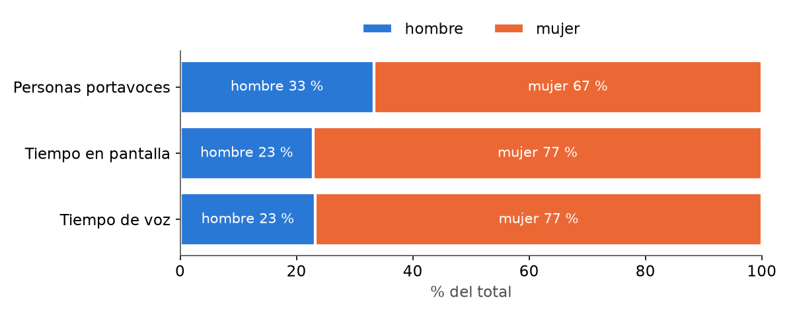
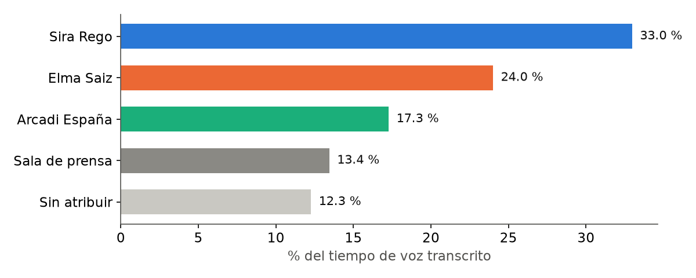

# Informe: consejo_131026

Fuente: https://www.lamoncloa.gob.es/multimedia/galeriasfotograficas/consejoministros/Paginas/2026/131026-rueda-prensa-consejo.aspx

- Emisión útil analizada: 40.6 min
- Abre: Elma Saiz · Cierra: Elma Saiz
- Turno de preguntas desde el minuto 26.8
- Voz sin atribuir: 12.3 %

## Paridad por género

Índice de paridad = % obtenido / % de personas (1 = proporcional).

| categoria   |   personas |   tiempo_pantalla_s |   tiempo_habla_s |   pct_personas |   pct_pantalla |   paridad_pantalla |   pct_habla |   paridad_habla |
|:------------|-----------:|--------------------:|-----------------:|---------------:|---------------:|-------------------:|------------:|----------------:|
| hombre      |          1 |              399.93 |           370.72 |          33.33 |          22.91 |               0.69 |       23.27 |            0.7  |
| mujer       |          2 |             1346.03 |          1222.6  |          66.67 |          77.09 |               1.16 |       76.73 |            1.15 |

## Por persona

| persona       | categoria   |   tiempo_pantalla_s |   pct_emision_util |   tiempo_habla_s |   palabras |   intervenciones |   duracion_media_s |
|:--------------|:------------|--------------------:|-------------------:|-----------------:|-----------:|-----------------:|-------------------:|
| Arcadi España | hombre      |               399.9 |               16.4 |            370.7 |       1163 |                5 |               80   |
| Elma Saiz     | mujer       |               566.7 |               23.2 |            515   |       1358 |               10 |               56.7 |
| Sira Rego     | mujer       |               779.3 |               32   |            707.6 |       1971 |                6 |              129.9 |

## Exposición frente a preguntas (s en primer plano)

| persona       |   exposicion |   preguntas |
|:--------------|-------------:|------------:|
| Arcadi España |        211.7 |       188.2 |
| Elma Saiz     |        306.5 |       260.3 |
| Sira Rego     |        426.3 |       353   |

## Reparto de la voz

