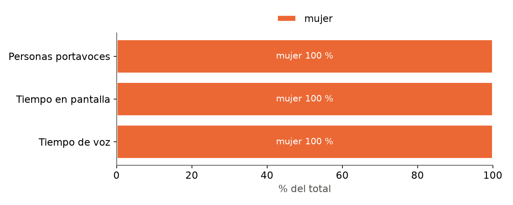
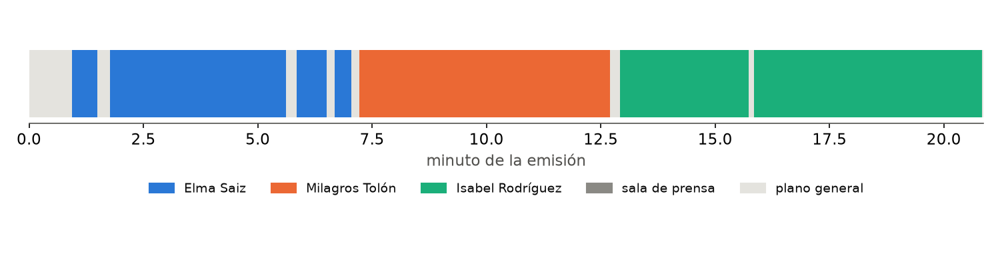
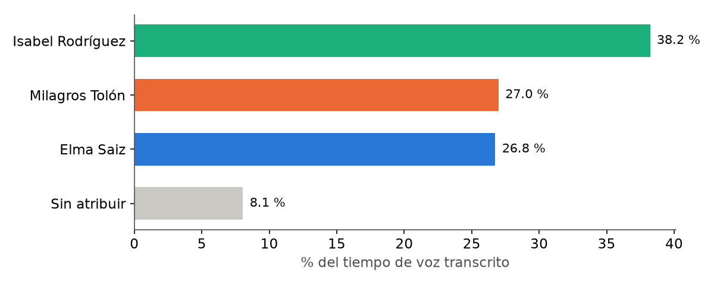

# Informe: consejo_271026

Fuente: https://www.lamoncloa.gob.es/consejodeministros/resumenes/Paginas/2026/271026-rueda-prensa-ministros.aspx

- Emisión útil analizada: 20.9 min
- Abre: Elma Saiz · Cierra: Isabel Rodríguez
- Sin turno de preguntas detectado
- Voz sin atribuir: 8.0 %

## Paridad por género

Índice de paridad = % obtenido / % de personas (1 = proporcional).

| categoria   |   personas |   tiempo_pantalla_s |   tiempo_habla_s |   pct_personas |   pct_pantalla |   paridad_pantalla |   pct_habla |   paridad_habla |
|:------------|-----------:|--------------------:|-----------------:|---------------:|---------------:|-------------------:|------------:|----------------:|
| mujer       |          3 |             1122.12 |          1036.68 |            100 |            100 |                  1 |         100 |               1 |

## Por persona

| persona          | categoria   |   tiempo_pantalla_s |   pct_emision_util |   tiempo_habla_s |   palabras |   intervenciones |   duracion_media_s |
|:-----------------|:------------|--------------------:|-------------------:|-----------------:|-----------:|-----------------:|-------------------:|
| Elma Saiz        | mujer       |               325.5 |               26   |            301.5 |        861 |                4 |               81.4 |
| Isabel Rodríguez | mujer       |               468   |               37.4 |            430.9 |       1271 |                2 |              234   |
| Milagros Tolón   | mujer       |               328.6 |               26.2 |            304.3 |        710 |                1 |              328.6 |

## Exposición frente a preguntas (s en primer plano)

| persona          |   exposicion |
|:-----------------|-------------:|
| Elma Saiz        |        325.5 |
| Isabel Rodríguez |        468   |
| Milagros Tolón   |        328.6 |

## Reparto de la voz

