<p align="center">
  
</p>

## 💜 Quiénes somos

<table>
<tr>
<td align="center" width="33%" valign="top">
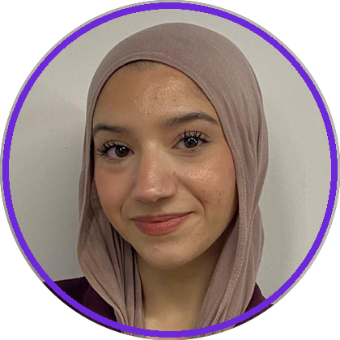<br>
<h3>Firdaous Boulahfa El Mourabit</h3>
<b>Lingüista computacional · AI Engineer</b><br>
<sub>📍 Madrid, España</sub>
<p align="left">Del lenguaje a la IA aplicada. En el proyecto se ocupó de las <b>métricas de protagonismo</b>, la <b>transcripción y atribución de la voz</b>, la <b>interfaz</b> y el <b>sistema automático</b> que analiza cualquier rueda de prensa de La Moncloa sin revisión manual.</p>
<a href="https://www.linkedin.com/in/firdaous-boulahfa-el-mourabit-871b11343/"></a>
<a href="https://github.com/bfir"></a>
<br><br>
<code>boulahfafirdaous@gmail.com</code>
</td>
<td align="center" width="33%" valign="top">
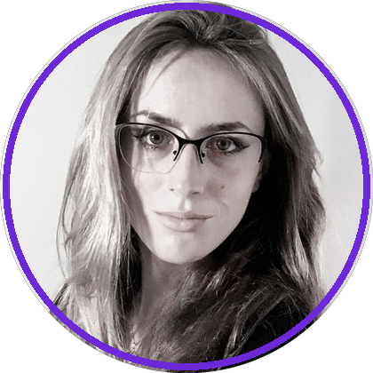<br>
<h3>Paula García Fernández, PhD</h3>
<b>Senior Data Scientist · Applied AI &amp; Computer Vision</b><br>
<sub>📍 Madrid, España</sub>
<p align="left">Visión por computador aplicada. En el proyecto construyó el <b>motor de visión integrado</b> (planos, personas y rótulos, reproducible y reanudable), probó los <b>modelos de imagen</b> y tomó la <b>decisión ética</b> de no inferir el género a partir de la cara.</p>
<a href="https://www.linkedin.com/in/paula-garcia-fernandez-pgf3712/"></a>
<a href="https://github.com/pgf3712"></a>
<br><br>
<code>infopaulagarciafernandez@gmail.com</code>
</td>
<td align="center" width="33%" valign="top">
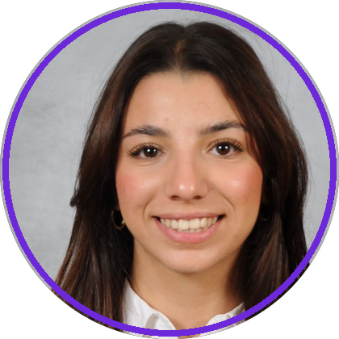<br>
<h3>Nouhaila Boulahfa El Mourabit</h3>
<b>Psicóloga · IT Recruiter · Metodología</b><br>
<sub>📍 Madrid, España</sub>
<p align="left">Psicología, personas y método. En el proyecto desarrolló la <b>detección de cortes de plano</b> y la <b>detección y seguimiento de personas</b>, y probó los modelos sobre la rueda de prensa para elegir los que usa el sistema.</p>
<a href="https://www.linkedin.com/in/nouhaila-boulahfa-el-mourabit-50773a350/"></a>
<a href="https://github.com/nouhailaboulahfa"></a>
<br><br>
<code>nouhailaboulahfa@gmail.com</code>
</td>
</tr>
</table>

---


<p align="center">
  
  
  
  
  
  
</p>

<p align="center">
  <a href="#-quiénes-somos">Quiénes somos</a> ·
  <a href="#-la-pregunta">La pregunta</a> ·
  <a href="#-qué-medimos">Qué medimos</a> ·
  <a href="#-resultados">Resultados</a> ·
  <a href="#-cómo-funciona">Cómo funciona</a> ·
  <a href="#-la-interfaz">Interfaz</a> ·
  <a href="#-instalación-y-uso">Instalación</a> ·
  <a href="#-de-prototipo-a-servicio-público">Producción</a>
</p>

<p align="center">
  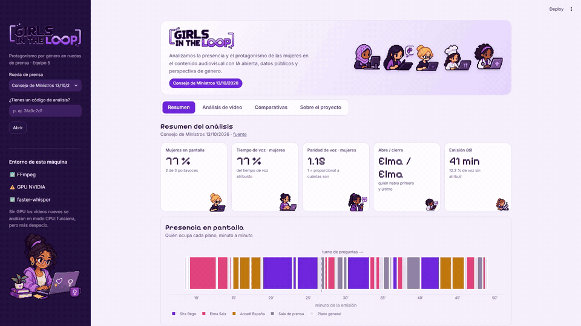
</p>

<p align="center">
  🎬 <a href="presentacion/Girls_in_the_Loop_video_5min.mp4"><b>Vídeo de presentación</b></a> (4 min) ·
  📑 <a href="presentacion/Girls_in_the_Loop_presentacion.pptx"><b>Presentación completa</b></a> ·
  ⏱️ <a href="presentacion/Girls_in_the_Loop_5min.pptx"><b>Presentación de 5 minutos</b></a>
</p>

> **Girls in the Loop** es un sistema de IA abierta que analiza solo, sin revisión manual, las ruedas de prensa del Consejo de Ministros: detecta quién ocupa la pantalla, transcribe quién tiene la palabra y mide si el protagonismo de mujeres y hombres es proporcional a cuántos comparecen. El género nunca se adivina a partir de la imagen: se documenta con el cargo oficial publicado.

---


##  La pregunta

En una rueda de prensa del Consejo de Ministros, **¿quién ocupa la pantalla y quién tiene la palabra?**

Contar cuántas mujeres aparecen no basta: una persona puede estar en el atril y apenas hablar. La **presencia** es estar; el **protagonismo** es tener la palabra, abrir y cerrar, intervenir más y durante más tiempo. Queremos medir las dos cosas con métricas explicables y comprobar si el protagonismo es proporcional al número de personas.

##  Qué medimos

| | Métrica | Qué mide |
|:-:|---|---|
| 🖥️ | **Tiempo en pantalla** | Segundos en primer plano de cada persona |
| 🎙️ | **Tiempo de voz** | Duración de las palabras atribuidas a cada persona |
| 🔁 | **Intervenciones** | Número de turnos y duración media |
| 🚪 | **Abre / cierra** | Quién habla primero y quién tiene la última palabra |
| ❓ | **Exposición / preguntas** | Reparto entre la parte preparada y el turno de preguntas |
| ⚖️ | **Índice de paridad** | % obtenido ÷ % de personas. **1 = proporcional**; > 1 = sobrerrepresentación |

## 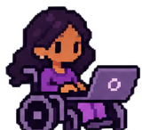 Resultados

### 13/10/2026 · dos mujeres y un hombre

<table>
<tr>
<td align="center" width="25%"><h3>77 %</h3>de la voz es de mujeres<br><sub>son el 67 % de quienes comparecen</sub></td>
<td align="center" width="25%"><h3>1,15</h3>paridad de voz de las mujeres<br><sub>1,16 en pantalla</sub></td>
<td align="center" width="25%"><h3>Elma / Elma</h3>la portavoz abre y cierra<br><sub>10 intervenciones</sub></td>
<td align="center" width="25%"><h3>33 %</h3>de la voz, Sira Rego<br><sub>quien más habla</sub></td>
</tr>
</table>

| | % personas | % pantalla | % voz | Paridad pantalla | Paridad voz |
|---|---:|---:|---:|---:|---:|
| Mujeres (2) | 66,7 | 77,1 | 76,7 | **1,16** | **1,15** |
| Hombres (1) | 33,3 | 22,9 | 23,3 | 0,69 | 0,70 |

En esta rueda de prensa las mujeres tienen **más protagonismo del que les correspondería por número**, y pantalla y voz coinciden. Fuente: [La Moncloa](https://www.lamoncloa.gob.es/consejodeministros/resumenes/Paginas/2026/131026-rueda-prensa-ministros.aspx) · 40,6 min de emisión útil.

<p align="center">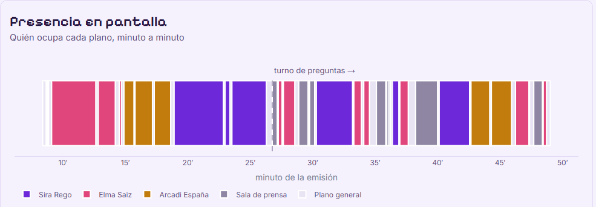</p>

<table>
<tr>
<td width="55%">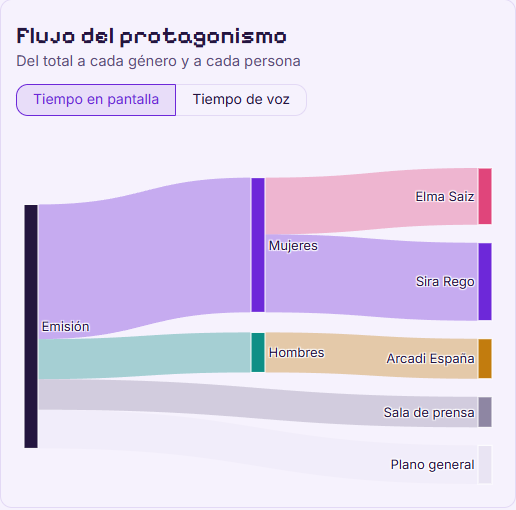</td>
<td width="45%">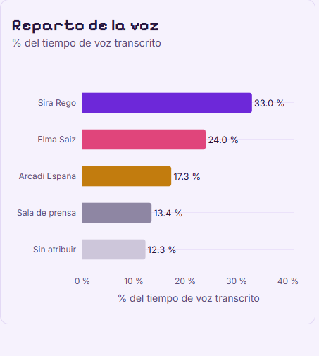</td>
</tr>
</table>

### 27/10/2026 · tres ministras

Isabel Rodríguez tiene el **38,2 %** de la voz, Milagros Tolón el 27,0 % y Elma Saiz el 26,8 %. Con solo mujeres la paridad es 1 por definición: lo que importa es el reparto entre personas. Fuente: [La Moncloa](https://www.lamoncloa.gob.es/consejodeministros/resumenes/Paginas/2026/271026-rueda-prensa-ministros.aspx) · 20,9 min.

<p align="center">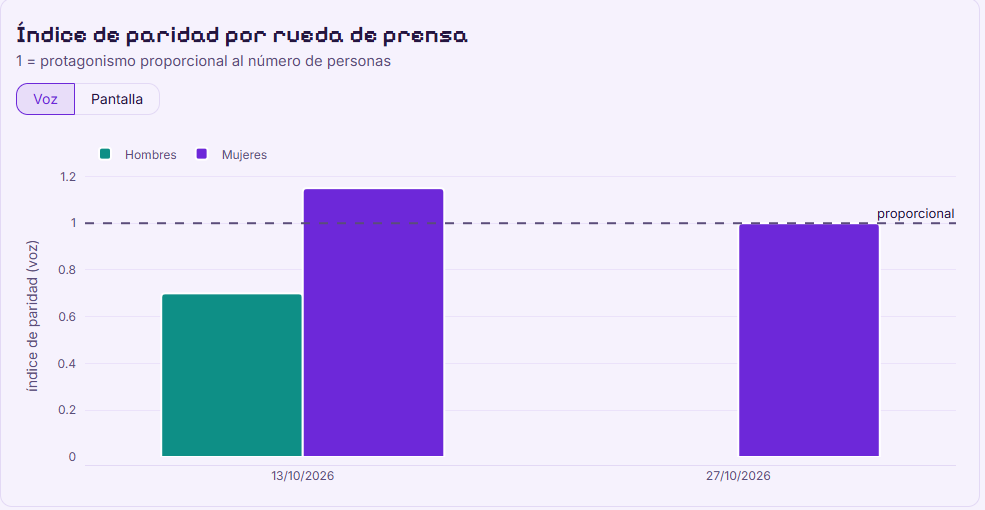</p>

> Con dos ruedas de prensa, los resultados describen esas sesiones, no una tendencia. Informes completos: [13/10](FIRDAOUS/salidas/consejo_131026/informe.md) · [27/10](FIRDAOUS/salidas/consejo_271026/informe.md).

##  Cómo funciona

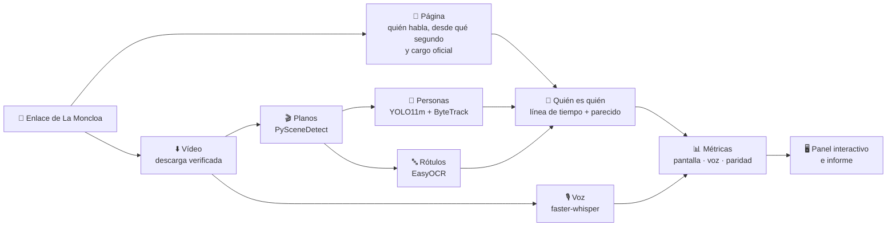

1. **Visión** (`PAULA/consejo_integrado`). Divide el vídeo en planos, detecta a las personas y las sigue dentro de cada plano (el seguimiento se reinicia en cada corte para que una identidad nunca salte entre tomas), lee los rótulos y verifica el tiempo real de cada fotograma. Guarda el progreso y puede continuar si se corta.
2. **Clasificación** (`FIRDAOUS/pipeline.py revisar`). Cada plano es primer plano, sala de prensa, plano general o se excluye.
3. **Quién es quién, sin revisión manual.** Cada primer plano se asigna a quien tiene la palabra según la línea de tiempo publicada por La Moncloa. Los planos sin marca se asignan a la persona de aspecto más parecido en el mismo vídeo. La corrección manual sigue disponible, pero no hace falta.
4. **Voz** (`pipeline.py metricas`). Whisper transcribe con el tiempo de cada palabra, y cada palabra se atribuye a quien está en primer plano. Lo que no se puede atribuir se declara como «sala» o «sin atribuir».
5. **Métricas, informe y panel.**

**Validación frente a la revisión hecha a mano**

| 13/10 · exposición | 27/10 | Solo por parecido |
|:-:|:-:|:-:|
| **9 / 9** primeros planos correctos | **7 / 7** primeros planos correctos | **3 / 3** planos recuperados |

##  Perspectiva de género y ética

- **El género se documenta, no se adivina.** Sale del cargo oficial publicado («Ministra…», «Ministro…»); si la fuente no lo documenta, queda «no documentado». Un prototipo que estimaba el género con DeepFace (`PAULA/prueba_imagen.ipynb`) se descartó por poco fiable y éticamente problemático.
- **Proporcionalidad, no solo porcentajes.** El índice de paridad compara el protagonismo con cuántas mujeres comparecen.
- **Voz, no solo imagen.** Estar en pantalla no es lo mismo que tener la palabra.
- **El parecido no es reconocimiento facial.** Compara colores (ropa, pelo, atril) entre planos del mismo vídeo para saber que es la misma persona; no estima ningún rasgo.
- **Solo cargos públicos en comparecencias públicas.** Periodistas y público no se identifican: la sala es una categoría.
- **Transparencia y reproducibilidad.** Cada resultado enlaza su fuente y guarda la huella del vídeo, del código y de los modelos.

##  La interfaz

<table>
<tr>
<td width="50%">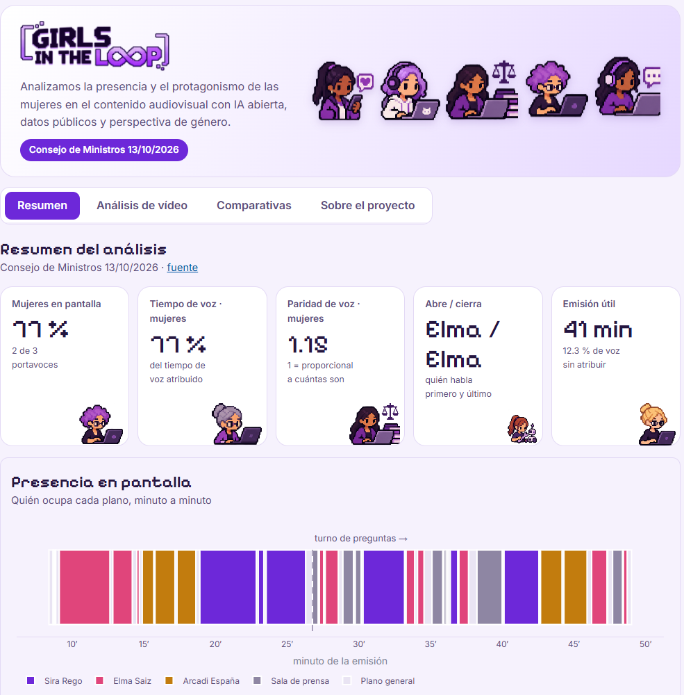</td>
<td width="50%">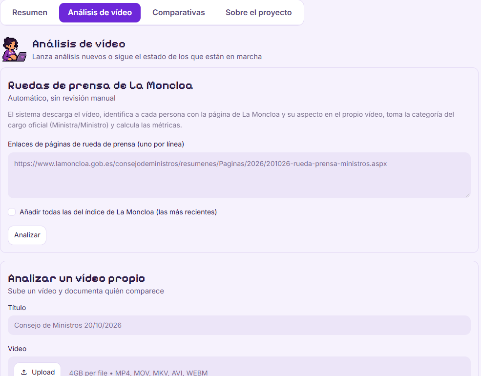</td>
</tr>
<tr>
<td><b>Resumen</b>: indicadores, presencia minuto a minuto, flujo del protagonismo, reparto de la voz, paridad, transcripción buscable y descargas.</td>
<td><b>Análisis de vídeo</b>: se pega un enlace de La Moncloa (o se piden todas las recientes) y el sistema hace el resto. También admite vídeos propios.</td>
</tr>
</table>

Además: **Comparativas** entre todas las ruedas analizadas y **Sobre el proyecto**, con el método y las decisiones éticas. Los análisis pesados pasan por una **cola** y se ejecutan de uno en uno; los vídeos subidos por una persona son **privados** y solo se ven con el enlace que lleva su código.

##  Instalación y uso

Requisitos: Python 3.10–3.13 y FFmpeg (`ffmpeg` y `ffprobe`). GPU CUDA recomendada; sin GPU todo funciona en CPU, más despacio (≈1–2 h por rueda de prensa).

```bash
pip install -r requirements.txt
streamlit run app.py          # en Windows también: doble clic en ABRIR_INTERFAZ.bat
```

Desde la terminal:

```bash
python moncloa.py URL [URL ...]                  # ruedas de prensa concretas
python moncloa.py --recientes                    # las del índice de La Moncloa
python moncloa.py --desde 2026-09-01 --hasta 2026-10-31

# o paso a paso con cualquier vídeo
python analizar_video.py PAULA/consejo_integrado/config_X.json FIRDAOUS/config_X.json
python FIRDAOUS/pipeline.py FIRDAOUS/config_X.json revisar|metricas|informe
```

##  De prototipo a servicio público

| Fase | Qué se hace |
|---|---|
| **1 · Piloto** | Despliegue en OVHcloud AI Deploy con GPU a partir del `Dockerfile`, con un volumen de Object Storage para vídeos y resultados. Análisis semanal automático con `moncloa.py --recientes`. |
| **2 · Validación** | Anotación manual de una muestra (`FIRDAOUS/anotacion_manual.csv`) para medir el error de clasificación de planos y de atribución de voz. |
| **3 · Publicación** | Panel público y datos abiertos en CSV con la serie histórica. |

```bash
docker build -t <registro>/girls-in-the-loop:1 . && docker push <registro>/girls-in-the-loop:1
ovhai app run <registro>/girls-in-the-loop:1 --gpu 1 --default-http-port 8080
```

**Permisos y acuerdos necesarios para un despliegue ético y legal**

- Acuerdo con La Moncloa / SEDIA para la descarga automatizada y periódica de los vídeos, y confirmación de las condiciones de reutilización de su aviso legal.
- Evaluación de impacto en protección de datos y consulta con la persona delegada de protección de datos de la entidad que lo opere.
- Aviso de transparencia público y canal de contacto para corregir errores de atribución.

<details>
<summary><b>Cumplimiento normativo</b></summary>

| Marco | Cómo lo tratamos |
|---|---|
| RGPD y LOPDGDD | Solo comparecencias públicas de cargos públicos en ejercicio; no se identifica a periodistas ni al público; sin categorías especiales de datos; minimización |
| Reglamento de IA (UE) 2024/1689 | No hay categorización biométrica: el género no se infiere de rasgos físicos. Sistema documentado y transparente, con supervisión humana opcional |
| Reutilización de información del sector público | Material publicado por La Moncloa, citado con su fuente en cada resultado; los vídeos no se redistribuyen |
| Licencias | Proyecto AGPL-3.0; componentes de terceros y sus licencias abajo |

</details>

<details>
<summary><b>Riesgos y mitigaciones</b></summary>

| Riesgo | Mitigación |
|---|---|
| Voz mal atribuida (habla alguien fuera de plano) | Se publica el % sin atribuir; diarización en la hoja de ruta |
| La Moncloa cambia el formato de su web | Lectura con reintentos; si falla una página, el lote sigue y se registra |
| Descargas incompletas | Descarga trozo a trozo con verificación de tamaño y reintentos |
| Lectura errónea de las cifras | Paridad explicada en cada panel; aviso cuando solo comparece un género |
| Categoría binaria limitada | Solo lo que documenta la fuente; categoría «no documentado» |
| Coste de GPU | Cola única de trabajos y modo CPU para volúmenes pequeños |

</details>

### Limitaciones

- **Dos ruedas de prensa:** las conclusiones no se pueden generalizar.
- **Los vídeos de La Moncloa no incluyen el turno de preguntas;** el del 13/10 procede de la emisión completa.
- **Atribución de voz aproximada:** asume que habla quien está en pantalla (12,3 % sin atribuir el 13/10; 8,0 % el 27/10).
- **Precisión de la clasificación de planos** aún no validada con una anotación manual amplia.

### Hoja de ruta

- [ ] Diarización de hablantes para el turno de preguntas
- [ ] Validación con anotación manual y publicación de las métricas de error
- [ ] Más fuentes: Congreso, Senado y RTVE
- [ ] Temas tratados por cada persona a partir de la transcripción
- [ ] Ejecución semanal automática y panel público
- [ ] Alternativa con licencia permisiva (detector BSD en lugar de YOLO)

<p align="center"><sub>Equipo 5 del reto <b>«Mujeres por la IA Abierta»</b> de la Secretaría de Estado de Digitalización e Inteligencia Artificial (SEDIA), en el marco de la Comunidad IA de Código Abierto. Colaboran UPC-IDEAI, COEINF (donesCOEINF) y OVHcloud.</sub></p>

<p align="center">
  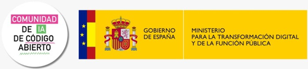&nbsp;&nbsp;
  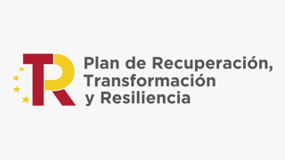&nbsp;&nbsp;
  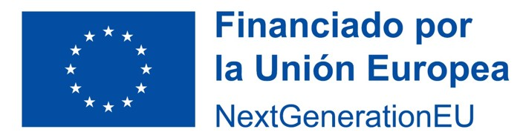&nbsp;&nbsp;
  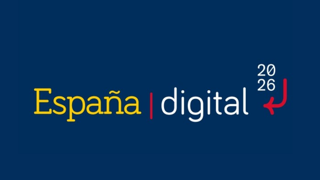
</p>

---

<details>
<summary><b>Estructura del repositorio</b></summary>

| Ruta | Contenido |
|---|---|
| `app.py`, `cola.py`, `assets/`, `.streamlit/` | Interfaz (Streamlit), cola de trabajos, avatares y logos, tema visual |
| `moncloa.py` | Análisis automático en lote de ruedas de prensa de La Moncloa |
| `analizar_video.py` | Valida y normaliza cualquier vídeo y lanza la visión |
| `PAULA/consejo_integrado/` | Motor de visión final (código, config y resultados) |
| `FIRDAOUS/pipeline.py`, `FIRDAOUS/config_*.json` | Clasificación, métricas e informe |
| `FIRDAOUS/salidas/` | Resultados: métricas CSV, transcripción, informes y gráficos |
| `Dockerfile` | Imagen para desplegar con GPU |
| `docs/readme/` | Imágenes de este README |
| `presentacion/` | Presentación completa (20 diapositivas), presentación de 5 minutos y vídeo de presentación del equipo (4 min 15 s) |
| `NOA/` | Prototipos de Nouhaila: cortes de plano, detección y seguimiento, pruebas de modelos |
| `PAULA/*.ipynb`, `PAULA/resultados/` | Prototipos de Paula: OCR, pruebas de imagen y motor en una celda |
| `FIRDAOUS/01_…08_*.py` | Prototipos de Firdaous, sustituidos por `pipeline.py` |

</details>

<details>
<summary><b>Componentes de terceros y licencias</b></summary>

| Componente | Uso | Licencia |
|---|---|---|
| Ultralytics YOLO11m | detección de personas | AGPL-3.0 |
| ByteTrack (vía Ultralytics) | seguimiento | MIT / AGPL-3.0 (Ultralytics) |
| PySceneDetect | cortes de plano | BSD-3-Clause |
| EasyOCR | rótulos | Apache-2.0 |
| faster-whisper + modelos Whisper | transcripción | MIT |
| FFmpeg | audio, vídeo y tiempos | LGPL/GPL |
| OpenCV, NumPy, pandas, matplotlib | procesado y gráficos | Apache-2.0 / BSD / PSF-compatible |
| Streamlit, Plotly | interfaz | Apache-2.0 / MIT |
| requests, Beautiful Soup | lectura de La Moncloa | Apache-2.0 / MIT |

</details>

**Licencia del proyecto: [AGPL-3.0](LICENSE)**, porque Ultralytics YOLO es AGPL-3.0 y exige esa licencia al sistema que lo usa. Los avatares y el logo son material propio del equipo; los logos de las entidades organizadoras y financiadoras se usan solo para identificarlas. Los vídeos son material público de La Moncloa y no se redistribuyen en el repositorio.
