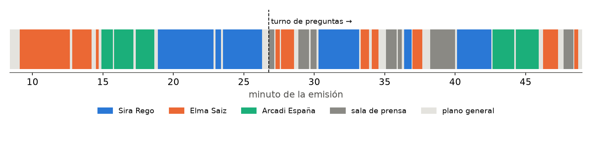

# Girls in the Loop · Protagonismo por género en las ruedas de prensa del Consejo de Ministros

*Open-source AI project for analyzing female representation and prominence in audiovisual content using computer vision, person detection, tracking, OCR, and explainable metrics.*

**Equipo 5 del reto «Mujeres por la IA Abierta»:** Nouhaila, Paula y Firdaous.

## Pregunta

En una rueda de prensa del Consejo de Ministros, ¿quién ocupa la pantalla y quién tiene la palabra? ¿Ese protagonismo es proporcional a cuántas mujeres y hombres comparecen?

## Métricas propuestas

| Métrica | Qué mide |
|---|---|
| Tiempo en pantalla | Segundos en primer plano de cada persona |
| Tiempo de voz | Duración de las palabras atribuidas a cada persona |
| Intervenciones | Número de turnos y duración media |
| Abre / cierra | Quién habla primero y quién tiene la última palabra |
| Exposición / preguntas | Reparto entre la parte preparada y el turno de preguntas |
| **Índice de paridad** | % obtenido ÷ % de personas. 1 = proporcional; > 1 = sobrerrepresentación |

## Resultados

**13/10/2026** ([La Moncloa](https://www.lamoncloa.gob.es/consejodeministros/resumenes/Paginas/2026/131026-rueda-prensa-ministros.aspx)) · 40,6 min de emisión útil · Elma Saiz (portavoz), Sira Rego y Arcadi España.

| | % personas | % pantalla | % voz | Paridad pantalla | Paridad voz |
|---|---:|---:|---:|---:|---:|
| Mujeres (2) | 66,7 | 77,1 | 76,7 | 1,16 | 1,15 |
| Hombres (1) | 33,3 | 22,9 | 23,3 | 0,69 | 0,70 |

Las mujeres tienen más protagonismo del que les correspondería por número. Elma Saiz abre y cierra; Sira Rego es quien más habla (33 % de la voz).

**27/10/2026** ([La Moncloa](https://www.lamoncloa.gob.es/consejodeministros/resumenes/Paginas/2026/271026-rueda-prensa-ministros.aspx)) · 20,9 min · tres ministras: Isabel Rodríguez (38,2 % de la voz), Milagros Tolón (27,0 %) y Elma Saiz (26,8 %). Con solo mujeres la paridad es 1 por definición; lo relevante es el reparto entre personas.

Con dos ruedas de prensa, los resultados describen esas sesiones, no una tendencia. Informes completos: [13/10](FIRDAOUS/salidas/consejo_131026/informe.md) · [27/10](FIRDAOUS/salidas/consejo_271026/informe.md).



## Cómo funciona

```
enlace de La Moncloa ──► moncloa.py: lee la página (quién habla, desde qué segundo, cargo oficial)
                          y descarga el vídeo trozo a trozo, verificando cada trozo
  │
  ▼  analizar_video.py → PAULA/consejo_integrado        (GPU o CPU)
  │  normaliza el vídeo si sus tiempos son irregulares
  │  cortes de plano (PySceneDetect) · personas (YOLO11m + ByteTrack, reiniciado en cada plano)
  │  rótulos (EasyOCR) · tiempos reales verificados con ffprobe · progreso reanudable (SQLite)
  │
  ▼  FIRDAOUS/pipeline.py revisar
  │  clasifica cada plano: primer plano / sala / plano general / excluir
  │  asigna cada primer plano a una persona: 1) línea de tiempo de La Moncloa,
  │  2) parecido de aspecto dentro del mismo vídeo, 3) rótulo OCR, 4) corrección manual (opcional)
  │
  ▼  FIRDAOUS/pipeline.py metricas
  │  transcripción con marcas por palabra (faster-whisper)
  │  cada palabra se atribuye a quien está en primer plano → métricas por persona, género y fase
  │
  ▼  FIRDAOUS/pipeline.py informe  → informe.md + gráficos     ·     app.py → panel interactivo
```

**Validación de la asignación automática frente a la revisión manual:** 9 de 9 primeros planos de la exposición del 13/10 y 7 de 7 del 27/10; el reconocimiento por parecido recuperó 3 de 3 planos ocultados.

### Decisiones de diseño

- **El género se documenta, no se infiere.** La categoría sale del cargo oficial publicado («Ministra…», «Ministro…»); si la fuente no la documenta, queda «no documentado». Un prototipo con DeepFace (`PAULA/prueba_imagen.ipynb`) se descartó por poco fiable y éticamente problemático.
- **El parecido no es reconocimiento facial.** Compara histogramas de color (ropa, pelo, atril) entre planos del mismo vídeo para saber que es la misma persona; no estima ningún rasgo.
- **Tracks por plano.** El seguimiento se reinicia en cada corte para que una identidad nunca salte entre tomas.
- **Atribución de voz por plano.** Voz durante planos de la sala = «sala»; durante planos generales = «sin atribuir». El porcentaje sin atribuir se publica siempre.
- **Reproducibilidad.** Se guarda la huella SHA-256 del vídeo, del código y de los pesos, y las versiones de cada librería.

## Instalación y uso

Requisitos: Python 3.10–3.13 y FFmpeg (`ffmpeg` y `ffprobe`). GPU CUDA recomendada; sin GPU todo funciona en CPU, más despacio (≈1–2 h por rueda de prensa).

```bash
pip install -r requirements.txt
streamlit run app.py          # en Windows también: doble clic en ABRIR_INTERFAZ.bat
```

| Pestaña | Qué hace |
|---|---|
| Resumen | Indicadores, presencia minuto a minuto, flujo del protagonismo, reparto de la voz, paridad, tabla por persona, transcripción buscable y descargas |
| Análisis de vídeo | Pegar enlaces de La Moncloa (o pedir todas las recientes) y analizarlos solos; o subir un vídeo propio. Estado de cada paso y registro |
| Comparativas | Índice de paridad de todas las ruedas analizadas |
| Sobre el proyecto | Cómo funciona, métricas y decisiones éticas |

Los análisis pesados pasan por una **cola** (`cola.py`) y se ejecutan de uno en uno. Los vídeos subidos por una persona son **privados**: solo se ven con el enlace que lleva su código (`?a=CÓDIGO`).

### Desde la terminal

```bash
python moncloa.py URL [URL ...]                  # ruedas de prensa concretas
python moncloa.py --recientes                    # las del índice de La Moncloa
python moncloa.py --desde 2026-09-01 --hasta 2026-10-31

# o paso a paso con cualquier vídeo
python analizar_video.py PAULA/consejo_integrado/config_X.json FIRDAOUS/config_X.json
python FIRDAOUS/pipeline.py FIRDAOUS/config_X.json revisar|metricas|informe
```

## Plan de puesta en producción

1. **Piloto.** Despliegue en OVHcloud AI Deploy con GPU a partir del `Dockerfile` (FFmpeg y dependencias incluidas, puerto 8080), con un volumen de Object Storage para conservar vídeos y resultados. Análisis semanal automático con `moncloa.py --recientes`.

   ```bash
   docker build -t <registro>/girls-in-the-loop:1 . && docker push <registro>/girls-in-the-loop:1
   ovhai app run <registro>/girls-in-the-loop:1 --gpu 1 --default-http-port 8080
   ```

2. **Validación.** Anotación manual de una muestra (plantilla en `FIRDAOUS/anotacion_manual.csv`) para medir el error de clasificación de planos y de atribución de voz antes de publicar.
3. **Publicación.** Panel público y datos abiertos en CSV con la serie histórica.

**Permisos y acuerdos necesarios para un despliegue ético y legal:**

- Acuerdo con La Moncloa / SEDIA para la descarga automatizada y periódica de los vídeos, y confirmación de las condiciones de reutilización de su aviso legal.
- Evaluación de impacto en protección de datos y consulta con la persona delegada de protección de datos de la entidad que lo opere.
- Aviso de transparencia público (qué se mide, con qué fuentes y con qué límites) y canal de contacto para corregir errores.

## Ética y cumplimiento normativo

| Marco | Cómo lo tratamos |
|---|---|
| RGPD y LOPDGDD | Solo comparecencias públicas de cargos públicos en ejercicio; no se identifica a periodistas ni al público (la sala es una categoría); sin categorías especiales de datos; minimización |
| Reglamento de IA (UE) 2024/1689 | No hay categorización biométrica: el género no se infiere de rasgos físicos. Sistema documentado y transparente, con supervisión humana opcional |
| Reutilización de información del sector público | Material publicado por La Moncloa, citado con su fuente en cada resultado; los vídeos no se redistribuyen |
| Licencias | Proyecto AGPL-3.0; componentes de terceros y sus licencias abajo |

### Riesgos y mitigaciones

| Riesgo | Mitigación |
|---|---|
| Voz mal atribuida (habla alguien fuera de plano) | Se publica el % sin atribuir; diarización en la hoja de ruta |
| La Moncloa cambia el formato de su web | Lectura con reintentos; si falla una página, el lote sigue y se registra |
| Descargas incompletas | Descarga trozo a trozo con verificación de tamaño y reintentos |
| Lectura errónea de las cifras | Paridad explicada en cada panel; aviso cuando solo comparece un género |
| Categoría binaria limitada | Solo lo que documenta la fuente; categoría «no documentado» |
| Coste de GPU | Cola única de trabajos y modo CPU para volúmenes pequeños |

## Limitaciones

- **Dos ruedas de prensa:** las conclusiones no se pueden generalizar.
- **Los vídeos de La Moncloa no incluyen el turno de preguntas;** el del 13/10 procede de la emisión completa.
- **Atribución de voz aproximada:** asume que habla quien está en pantalla (12,3 % de voz sin atribuir el 13/10, 8,0 % el 27/10).
- **Precisión de la clasificación de planos** aún no validada con una anotación manual amplia.

## Hoja de ruta

- Diarización de hablantes para atribuir la voz en el turno de preguntas.
- Validación con anotación manual y publicación de las métricas de error.
- Más fuentes: Congreso, Senado y RTVE.
- Modalidad texto: temas tratados por cada persona a partir de la transcripción.
- Ejecución semanal automática y panel público con la serie histórica.
- Alternativa con licencia permisiva: sustituir YOLO por un detector BSD (p. ej. Faster R-CNN de torchvision, ya probado en `PAULA/prueba_imagen.ipynb`).

## Estructura del repositorio

| Ruta | Contenido |
|---|---|
| `app.py`, `cola.py`, `assets/`, `.streamlit/` | Interfaz (Streamlit), cola de trabajos, avatares y logos, tema visual |
| `moncloa.py` | Análisis automático en lote de ruedas de prensa de La Moncloa |
| `analizar_video.py` | Valida y normaliza cualquier vídeo y lanza la visión |
| `PAULA/consejo_integrado/` | Motor de visión final (código, config y resultados) |
| `FIRDAOUS/pipeline.py`, `FIRDAOUS/config_*.json` | Clasificación, métricas e informe |
| `FIRDAOUS/salidas/` | Resultados: métricas CSV, transcripción, informes y gráficos |
| `Dockerfile` | Imagen para desplegar con GPU |
| `NOA/` | Prototipos de Nouhaila: cortes de plano, detección y seguimiento, pruebas de modelos |
| `PAULA/*.ipynb`, `PAULA/resultados/` | Prototipos de Paula: OCR, pruebas de imagen y motor en una celda |
| `FIRDAOUS/01_…08_*.py` | Prototipos de Firdaous, sustituidos por `pipeline.py` |

## Componentes de terceros y licencias

| Componente | Uso | Licencia |
|---|---|---|
| Ultralytics YOLO11m | detección de personas | AGPL-3.0 |
| ByteTrack (vía Ultralytics) | seguimiento | MIT / AGPL-3.0 (Ultralytics) |
| PySceneDetect | cortes de plano | BSD-3-Clause |
| EasyOCR | rótulos | Apache-2.0 |
| faster-whisper + modelos Whisper | transcripción | MIT |
| FFmpeg | audio, vídeo y tiempos | LGPL/GPL |
| OpenCV, NumPy, pandas, matplotlib | procesado y gráficos | Apache-2.0 / BSD / PSF-compatible |
| Streamlit, Plotly | interfaz | Apache-2.0 / MIT |
| requests, Beautiful Soup | lectura de La Moncloa | Apache-2.0 / MIT |

**Licencia del proyecto: AGPL-3.0** (ver `LICENSE`), porque Ultralytics YOLO es AGPL-3.0 y exige esa licencia al sistema que lo usa.

Los avatares y el logo de `assets/` son material propio del equipo. Los logos de las entidades organizadoras y financiadoras se usan solo para identificarlas. Los vídeos son material público de La Moncloa y no se redistribuyen en el repositorio.
